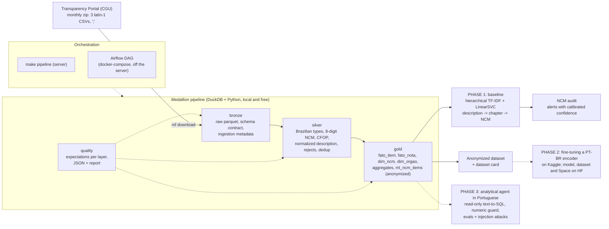

# Raio-X Fiscal

[Português](README.md) · **English**

An AI platform for the accounting and tax domain, built on **public Brazilian electronic invoices**
(NF-e, *Nota Fiscal eletrônica*: the mandatory digital invoice every Brazilian sale is issued on), taken
from federal government purchases published by the Transparency Portal. It has a medallion pipeline in
DuckDB with measured data quality, a machine learning baseline that **classifies a free-text product
description into its NCM code**, and an audit that flags declared NCM codes that are probably wrong.

**NCM** (*Nomenclatura Comum do Mercosul*) is the 8-digit product code used across Mercosur, the regional
extension of the international Harmonized System (HS). Every line item on a Brazilian invoice carries
one, and it drives the tax rates applied to that item.

> The detailed reports in [`reports/`](reports/) and the original dataset card are written in
> Portuguese. An English version of the dataset card is at [docs/DATASET_CARD.en.md](docs/DATASET_CARD.en.md).

<!-- RESULTS_BOX_START -->
> **Results (PHASE 1, measured on 2026-11-04).** 6 months (2025-04 to 2025-09), **878,858 invoices** and
> **3,124,925 line items** (R$ 46.5 bn in items), 7,381 distinct NCMs, 0 rejected rows and 0 duplicates,
> 98.8% to 99.2% of items with a valid NCM. Inconsistencies found and documented: the sum of the items
> differs from the invoice total in 14% to 23% of invoices per month; the buying agency is missing in 83%
> of the rows of the items file (but present in 98.5% of the invoices); 4,344 invoices with no items.
> Description -> NCM baseline (hierarchical TF-IDF + LinearSVC, CPU only): **78.7%** accuracy on the
> 8-digit NCM in the test month and **60.0% / 76.1%** (top-1 / top-5) on never-seen descriptions. NCM
> audit: 3,580 alerts in the test month; in a manual inspection of 60, **50 (83%)** were a wrong declared
> NCM with the model's suggestion correct, and 3 (5%) were model errors.
<!-- RESULTS_BOX_END -->

---

## The problem

Every Brazilian invoice classifies each line item with an **NCM** code (8 digits, an extension of the
Harmonized System). The NCM decides federal excise tax (IPI), PIS/COFINS, ICMS-ST (state tax collected
in advance) and eligibility for tax incentives. In practice the code is chosen by the supplier, from a
free-text description ("ARROZ TIPO 1", "CABO FLEXIVEL 2,5MM2 750V"), and the accounting firm inherits
the mistake: it either overpays tax, or underpays and gets fined later.

Two facts make this a data problem and an AI problem at the same time:

1. The same text gets different NCMs from different suppliers. In this data, among test items whose
   exact description already existed in training, the NCM matches in only **86.5%** of cases.
2. The volume is large and repetitive: 3.1 million items in six months, but only ~900 thousand
   distinct descriptions. Any evaluation that ignores the repetition measures memory, not generalization.

It is the same problem as **catalogue categorization** in a marketplace: short, noisy text typed by
third parties, thousands of hierarchical classes, and a real cost when the class comes out wrong.

## What this repository proves (PHASE 1)

1. **Reproducible, cheap data engineering** (`src/raio_x_fiscal/pipeline/`): monthly zip from the CGU
   (the federal comptroller; latin-1 CSV, `;` separator, comma as decimal mark) -> bronze -> silver ->
   gold in DuckDB, local, idempotent per month, with a schema contract that fails loudly when the source
   changes.
2. **Data quality as code** (`pipeline/quality.py`): explicit expectations per layer, numbers stored as
   JSON and a markdown report with what was measured, including what does not reconcile
   ([reports/quality_report.md](reports/quality_report.md)).
3. **An honest ML baseline** (`src/raio_x_fiscal/ml/`): temporal split, dedup by normalized
   description, the "as in production" number reported next to the "never-seen descriptions" number,
   calibration on a separate validation month, measured latency
   ([reports/ml_results.md](reports/ml_results.md)).
4. **A business application**: an NCM audit with a threshold chosen for a target precision and a sample
   inspected by hand, stating how many alerts look like real errors and how many are model errors
   ([reports/ncm_audit.md](reports/ncm_audit.md), [reports/ncm_audit_inspection.md](reports/ncm_audit_inspection.md)).
5. **Orchestration both ways**: `make pipeline` from the CLI on the server and the same sequence as an
   Airflow DAG with dynamic task mapping per month (`dags/`, `airflow/docker-compose.yml`), parse
   validated with Airflow 2.10.5.
6. **An anonymized dataset ready to publish** in PHASE 2 (Kaggle / Hugging Face), with a dataset card
   ([docs/DATASET_CARD.en.md](docs/DATASET_CARD.en.md)).

## Architecture



The three layers live in `data/` (outside git): `bronze/<entity>/mes=AAAAMM/`,
`silver/<entity>/mes=AAAAMM/` (Parquet partitioned by month) and `gold/raio_x_fiscal.duckdb` (plus a
Parquet export of each table). Reprocessing a month replaces its partition; gold is rebuilt from
scratch (`CREATE OR REPLACE`). Running twice gives the same result.

## Data source, license and LGPD

- **Source:** Transparency Portal (*Portal da Transparência*, run by the CGU, *Controladoria-Geral da
  União*), dataset "Notas Fiscais", monthly download at
  `https://portaldatransparencia.gov.br/download-de-dados/notas-fiscais/AAAAMM` (redirects to the CGU
  open data bucket). Three files per month: `NotaFiscal` (invoice header), `NotaFiscalItem` (line items)
  and `NotaFiscalEvento` (events; empty in the processed months).
- **Data license:** federal government open data. The dados.gov.br catalogue lists the CGU datasets
  under the **ODbL (Open Database License)**; before publishing the derived dataset in PHASE 2 this will
  be confirmed on the dataset page and cited in the card. The code in this repository is MIT.
- **LGPD** (*Lei Geral de Proteção de Dados*, Brazil's data protection law, similar to GDPR): the issuer
  of an NF-e can be an individual (identified by a CPF, the personal taxpayer number). Rules applied:
  - in **gold**, the CPF becomes a salted hash (`cpf:<16 hex>`) and the individual's name is dropped;
    company CNPJs (corporate taxpayer numbers) stay, since a public purchase from a company is public
    information. The check `fato_nota_cpf_mascarado` enforces this on every build. In the six processed
    months no invoice was issued by a CPF, so the rule is covered by the tests, not by the data;
  - the ML table (`ml_ncm_items`) and the publishable dataset **do not carry** the access key, CPF/CNPJ,
    company name, state registration, or the buyer's CNPJ/name. What remains is description, NCM, CFOP,
    unit, quantity, values, state (UF) and month. `item_id` is an md5 of the key + item number. The check
    `ml_sem_identificadores` fails the build if any of those columns shows up.

## Medallion pipeline

| Layer | What it does | Key / idempotency |
|---|---|---|
| **bronze** (`bronze.py`) | extracts the zip, validates the header against the contract (`schema.py`), reads the CSV with DuckDB (`encoding='latin-1'`, everything VARCHAR), writes ZSTD Parquet + `_mes_referencia`, `_source_file`, `_ingested_at`, a JSON manifest; deletes the extracted CSV | one partition per month and entity; reprocessing replaces it |
| **silver** (`silver.py`) | renames to snake_case, casts types (`DECIMAL` from `1.234,56`, `DATE` from `dd/mm/aaaa`, integer codes), normalizes the NCM to 8 digits (the CSV drops the leading zero of chapters 01 to 09 and uses `-1` for missing), validates the CFOP (fiscal operation code), normalizes the description (lowercase, no accents, only `[a-z0-9]`), splits **rejects** with a reason (key without 44 digits, invalid date or value), deduplicates on the natural key | invoice: `chave_acesso`; item: `(chave_acesso, numero_produto)` |
| **gold** (`gold.py`) | `fato_item`, `fato_nota`, `dim_ncm` (chapter/heading/subheading + most frequent official description), `dim_capitulo` (97 chapters and sections, seed), `dim_cfop`, `dim_orgao`, `dim_destinatario`, `dim_uf`; aggregates `agg_gasto_ncm_mes`, `agg_gasto_orgao_mes`, `agg_gasto_capitulo_uf_mes`; anonymized `ml_ncm_items` | full refresh into one DuckDB file + Parquet export |

The normalization rules exist in **SQL (silver) and in Python (inference)**, and a test makes sure both
versions agree (`tests/test_normalize.py::test_sql_and_python_rules_agree`).

### Data quality: what was measured

Summary per month (silver). Full report, with every check and its details, in
[reports/quality_report.md](reports/quality_report.md) (in Portuguese).

| Month | Invoices | Items | Rejected | Duplicates | Valid NCM | qty x unit = total | Sum of items = invoice |
|---|---:|---:|---:|---:|---:|---:|---:|
| 2025-04 | 128,641 | 470,126 | 0 | 0 | 99.11% | 100% | 77.37% |
| 2025-05 | 143,760 | 523,639 | 0 | 0 | 99.13% | 100% | 84.46% |
| 2025-06 | 147,791 | 517,843 | 0 | 0 | 99.12% | 100% | 85.17% |
| 2025-07 | 173,981 | 569,088 | 0 | 0 | 99.22% | 100% | 85.92% |
| 2025-08 | 135,999 | 489,660 | 0 | 0 | 98.83% | 100% | 83.30% |
| 2025-09 | 148,686 | 554,569 | 0 | 0 | 98.78% | 100% | 83.90% |

Inconsistencies found (logged as `warn`/`info`, not hidden):

- **Sum of items vs. invoice total** matches in 77% to 86% of invoices. Where it does not, in half the
  cases the items add up to more (an unconditional discount applied to the invoice total) and in the
  other half to less (freight, IPI, ICMS-ST and other ancillary charges are included in the total).
  Across the six months the items add up to **R$ 46.5 bn** and the invoices to **R$ 39.3 bn**; the gap
  (R$ 7.7 bn of items above the invoice) is concentrated in chapter 30 (pharmaceutical products,
  Ministry of Health purchases with large discounts over list price). That is why item value and invoice
  value are separate facts in gold.
- **Invalid NCM** in 0.8% to 1.2% of items: almost all of it is the `-1` sentinel ("no NCM", typical of
  services described as an item); a small residue has a chapter that does not exist. 85 thousand items
  per month came with 7 digits because the leading zero was lost: fixed, not discarded.
- **Buying agency** shows as "Sem informação" (no information) in **83% of the rows of the items file**,
  but it is filled in 98.5% of the invoices. Gold takes the agency from the invoice when the item has none.
- **Invoices with no items**: 4,296 in 2025-04 (and a handful in the other months); 0 orphan items.
- `quantidade x valor_unitario = valor_total` closes on 100% of items, and there is no key outside 44
  digits, no duplicate and no invalid CFOP in these six months: the rules exist because the pipeline has
  to survive the month this changes, not because it already happened.

## ML baseline: description -> NCM

### Protocol

- **Temporal split**: train 2025-04 to 2025-07, validation 2025-08 (only to calibrate temperatures and
  pick the audit threshold), test 2025-09. Nothing from the test month touches fitting.
- **Dedup**: training collapses to **one row per normalized description** (526,441 descriptions, from
  2.06 million items), label = most frequent NCM for that description, weight `log(1 + ocorrencias)`.
  3.6% of descriptions appear with more than one NCM, but they account for **26% of items**: that is the
  label-noise ceiling of the problem.
- **Four test subsets**, all reported: `todos` (all 547,718 items, as in production), `unicos` (206,928
  distinct descriptions), `nao_vistos` (items whose description never appeared in training) and
  `nao_vistos_unicos` (126,723 descriptions; the honest generalization number).
- **Models**: majority class; exact lookup (memorization); **word (1-2) + character (3-5) TF-IDF, 400
  thousand dimensions, a chapter-level LinearSVC (96 classes) and one LinearSVC per chapter for the NCM**
  (a flat model with ~6.6 thousand classes x 400 thousand features would need ~20 GB of coefficients; the
  hierarchy brings it down to the sum of `classes_do_capitulo x features_presentes_no_capitulo`); and a
  hybrid lookup -> SVM. Probabilities via **temperature scaling** fitted on the validation month,
  `P(ncm) = P(capitulo) x P(ncm | capitulo)`.

<!-- ML_RESULTS_START -->
### Baseline results

Test month 2025-09 (547,718 items). Full table (four subsets, weighted F1), calibration, per-chapter
performance, confusions and error examples in [reports/ml_results.md](reports/ml_results.md) (in
Portuguese).

| Task | Model | All items: top-1 / top-5 | Never seen, unique: top-1 / top-5 | Macro F1 (never seen) |
|---|---|---:|---:|---:|
| Chapter (2 digits) | majority class | 7.6% / 30.7% | 5.4% / 27.8% | 0.1% |
| Chapter | exact lookup | 65.3% / 73.8% | 5.4% / 27.8% | 0.1% |
| Chapter | TF-IDF + LinearSVC | **89.0% / 96.0%** | **79.7% / 92.4%** | 60.3% |
| Chapter | hybrid lookup -> SVM | 89.5% / 93.9% | 79.3% / 87.8% | 59.2% |
| NCM (8 digits) | majority class | 5.8% / 18.1% | 4.2% / 13.5% | 0.0% |
| NCM | exact lookup | 60.0% / 64.1% | 4.2% / 13.5% | 0.0% |
| NCM | hierarchical TF-IDF + LinearSVC | 77.3% / 87.7% | **60.0% / 76.1%** | 26.5% |
| NCM | hybrid lookup -> SVM | **78.7% / 87.8%** | 60.0% / 76.1% | 26.5% |

What the numbers say:

- **Memorizing does not generalize.** Exact lookup reaches 60% on the NCM because 68% of the month's
  items repeat a training description; on the 126,723 never-seen descriptions it drops to the level of
  the majority class. That is why the reference number is the "never seen, unique" column.
- **Noise ceiling.** On items whose description was already in training, the declared NCM matches the
  training one in only 86.5%: part of any model's "error" is a label error (the audit below confirms it).
- **Long tail.** 6,583 NCMs in training, many with few examples: macro F1 of 26.5% against a weighted F1
  of 57.7% on never-seen descriptions. This is what PHASE 2 (a Portuguese encoder) has to improve.
- **Cost.** Training on a single CPU core: 28 min (chapter) + 15 min (NCM), peak of ~2.9 GB of RAM,
  resumable from checkpoints. Inference: 0.23 ms/item in batch (the whole test month in 92 s) and 150 ms
  (p50) for a single item. A 215 MB model, pruned to sparse with 99.6% top-1 agreement with the dense
  model.
<!-- ML_RESULTS_END -->

### NCM audit

<!-- AUDIT_START -->
An alert is an item whose declared NCM differs from the prediction with confidence above the threshold.
The threshold was chosen on the validation month. The goal was 95% precision, but it is not reachable:
"precision" there means agreement with the declared NCM, which is noisy. So the threshold with the
highest measured precision is used: **0.99** (92.0% on 45,234 items).

- **Test month:** 3,580 alerts (0.65% of items), across 723 distinct descriptions, totalling
  R$ 2.63 mn; 1,305 of them change even the chapter. Details in [reports/ncm_audit.md](reports/ncm_audit.md).
- **Manual inspection of 60 random alerts**
  ([reports/ncm_audit_inspection.md](reports/ncm_audit_inspection.md)): **50 (83%, 95% CI 72% to 91%)**
  are a wrong declared NCM with the model's suggestion correct (e.g. carrots declared as "horses", wheat
  flour as "cotton waste", tomatoes as "other vegetables"); 5 are books in a neighbouring code, with no
  tax impact; 1 is ambiguous; 1 has both the declared and the predicted code wrong; **3 (5%)** are model
  errors.
- **Caveat:** 45% of the alerts are fresh vegetables and fruit, which usually carry zero federal tax on
  both sides of the mistake. The summed value measures volume, not recoverable tax. The honest use is to
  prioritize human review of the supplier's product registry, not to correct NCMs automatically.
<!-- AUDIT_END -->

## How to run

Requirements: Python 3.11+, ~2 GB of free RAM for the pipeline (DuckDB capped at 1.5 GB) and ~4 GB to
train the baseline; ~3 GB of disk for six months (zips + Parquet + DuckDB) and ~1 GB for the models.

```bash
make install                         # creates .venv and installs the package (editable) + dev
make pipeline MESES=202504-202509    # download -> bronze -> silver -> quality -> gold -> report
make ml                              # ml-dataset (temporal split) -> ml-train -> ml-audit
make publish                         # anonymized dataset + manifest in data/publish/ (does not publish)
make test && make lint               # offline pytest (small fixtures) and ruff

# inference
.venv/bin/python -m raio_x_fiscal.ml.predict "ARROZ TIPO 1" "Vidro temperado 6mm" --k 3
```

Optional environment variables: `RXF_DATA_DIR`, `RXF_MODELS_DIR`, `RXF_DUCKDB_MEMORY` (default
`1500MB`), `RXF_DUCKDB_THREADS` (default `2`), `RXF_HASH_SALT` (salt for the CPF hash).

**Airflow** (off the production server): `cd airflow && echo "AIRFLOW_UID=$(id -u)" > .env &&
docker compose up airflow-init && docker compose up`, then `http://localhost:8080`. The
`raio_x_fiscal_pipeline` DAG runs `download -> bronze -> silver -> quality` mapped per month (param
`meses`) and then `gold -> quality_gold -> report`; each task calls the same function from
`pipeline/tasks.py` that the CLI uses. The DAG parse was validated with `DagBag` on Airflow 2.10.5
(`tests/test_cli_dag.py`, skipped automatically when Airflow is not installed).

## Layout

```
raio-x-fiscal/
├── src/raio_x_fiscal/
│   ├── config.py             # Paths, months, DuckDB connection with a memory cap
│   ├── cli.py                # rxf: download | bronze | silver | quality | pipeline | gold | ml-* | publish
│   ├── pipeline/
│   │   ├── schema.py         # column contract for the 3 CSVs (bronze fails if it changes)
│   │   ├── normalize.py      # pure rules in Python and in SQL (NCM, CFOP, BR decimal, description)
│   │   ├── download.py       # idempotent monthly zip + sha256 manifest
│   │   ├── bronze.py / silver.py / gold.py
│   │   ├── quality.py        # expectations per layer, JSON + markdown report
│   │   └── tasks.py          # functions shared by the CLI and the DAG
│   ├── ml/
│   │   ├── dataset.py        # temporal split + dedup + leakage flags
│   │   ├── features.py       # word + character TF-IDF (float32)
│   │   ├── models.py         # majority, lookup, calibrated hierarchical SVM
│   │   ├── evaluate.py       # metrics, confusion, latency, calibration
│   │   ├── train.py          # training, evaluation, reports/ml_results.md
│   │   ├── audit.py          # NCM alerts + sample for inspection
│   │   └── predict.py        # inference from the CLI / NcmPredictor class
│   ├── publish/dataset.py    # anonymized dataset for Kaggle/HF
│   └── seeds/                # NCM chapters (97) and states (UF)
├── dags/raio_x_fiscal_dag.py # Airflow (TaskFlow, dynamic mapping per month)
├── airflow/docker-compose.yml
├── tests/                    # offline pytest, latin-1 fixture with edge cases
├── reports/                  # quality_report.md, ml_results.md, ncm_audit*.md (real numbers, in Portuguese)
├── docs/DATASET_CARD.md      # dataset card (Portuguese); DATASET_CARD.en.md (English)
├── data/ (gitignored)        # raw/ bronze/ silver/ gold/ quality/ ml/ publish/
└── models/ (gitignored)      # featurizer, hierarchical SVM, lookup, metadata.json
```

## Decisions and limitations

- **DuckDB instead of Spark/Databricks**: 3 million rows per semester fit on an 8 GB machine; the
  medallion pattern is the same and the cost is zero. The structure (monthly partitions, schema
  contract, rejects, expectations) is what would move to Delta/Databricks without changing shape.
- **Parquet per partition + DuckDB for gold**: gold is a single file because PHASE 3 needs a database
  that can be queried with read-only SQL; the Parquet export exists for anyone not using DuckDB.
- **Label = NCM declared by the supplier**, which is noisy (26% of items have an ambiguous
  description). Every accuracy figure here is "agreement with the declared code", and part of the
  model's error is being right against a wrong label. The audit exploits exactly that.
- **A linear model, not a transformer**, on purpose: it is the baseline PHASE 2 has to beat, it runs on
  CPU in milliseconds and it is explainable through n-gram weights.
- **Temperature-calibrated confidence** is cheap and a big improvement over the raw SVM score, but it is
  still an approximation; the audit threshold was chosen empirically on the validation month.
- **Rare chapters** (few descriptions) have low F1 and macro F1 reflects that; weighted F1 is the
  operational number.
- **Events** (cancellation, correction letter) came empty in all six months; the layer is ready but has
  not been exercised by real data.
- **No CPF** appeared as an issuer in these months; the mask is tested on a fixture, not in production.

## Roadmap

**PHASE 2: a published model.** Fine-tuning a Portuguese encoder (BERTimbau base or similar) on Kaggle
(free GPU) over this phase's anonymized dataset, with the same split protocol and the same four
subsets, for a direct comparison with the baseline. Deliverables: dataset + notebook on Kaggle, model +
dataset on Hugging Face, and a Space with the inference demo and the NCM audit.

**PHASE 3: an analytical agent.** Questions in Portuguese over the gold layer ("how much did the
Ministry of Health spend on NCM 3004 in August, by state?") answered through **read-only** text-to-SQL
(DuckDB read-only, an allow-list of tables, row and time limits), with a **numeric guard**: every
number in the answer text must exist in the query result, otherwise the answer is blocked and
regenerated. Evals with known-answer questions and prompt-injection attacks, cost per role, a pinned
judge, a budget guard and an HTML report, reusing the evaluation harness I already use for my WhatsApp
agents (12 personas, simulated customer, pinned judge, cost per role; private repository). Public demo with a daily usage cap;
the API key stays on the server only.

## Tests and lint

`make test` runs 50+ offline tests in seconds: parsing of the latin-1 CSV and Brazilian decimals,
schema contract (drift fails), normalization rules in Python and SQL (parity), rejects and dedup,
bronze/silver/gold idempotency, expectations with the known inconsistencies of the fixture, CPF
masking, a leakage-free split, the hierarchical model (shapes, probabilities, calibration), inference
after a `joblib` round trip, the CLI parser and the DAG structure. `make lint` runs `ruff check` and
`ruff format --check`.

## License

Code under MIT (see `LICENSE`). Data: Transparency Portal / CGU, open data (see the section "Data
source, license and LGPD").
