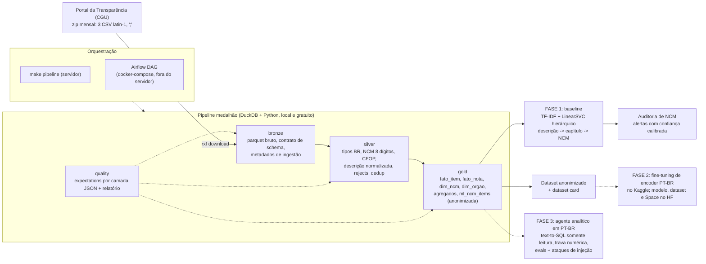

# Raio-X Fiscal

**Português** · [English](README.en.md)

Plataforma de IA para o setor contábil construída sobre **notas fiscais eletrônicas públicas**
(compras do governo federal, Portal da Transparência): pipeline medalhão em DuckDB com qualidade
de dados medida, baseline de machine learning para **classificar descrição de produto em NCM**, e
uma auditoria que aponta NCMs declarados que provavelmente estão errados.

<!-- RESULTS_BOX_START -->
> **Resultados (FASE 1, medidos em 04/11/2026).** 6 meses (2025-04 a 2025-09), **878.858 notas** e
> **3.124.925 itens** (R$ 46,5 bi em itens), 7.381 NCMs distintos, 0 linhas rejeitadas e 0 duplicatas,
> 98,8% a 99,2% dos itens com NCM válido. Divergências encontradas e documentadas: soma dos itens
> diferente do total da nota em 14% a 23% das notas por mês; órgão destinatário ausente em 83% das
> linhas do arquivo de itens (mas presente em 98,5% das notas); 4.344 notas sem nenhum item.
> Baseline descrição -> NCM (TF-IDF + LinearSVC hierárquico, só CPU): **78,7%** de acerto no NCM de 8
> dígitos no mês de teste e **60,0% / 76,1%** (top-1 / top-5) nas descrições nunca vistas. Auditoria de
> NCM: 3.580 alertas no mês de teste; numa inspeção manual de 60, **50 (83%)** eram NCM declarado errado
> com a sugestão do modelo correta, e 3 (5%) eram erro do modelo.
<!-- RESULTS_BOX_END -->

---

## O problema

Toda nota fiscal brasileira classifica cada item com um **NCM** (Nomenclatura Comum do Mercosul, 8
dígitos, extensão do Sistema Harmonizado). O NCM decide IPI, PIS/COFINS, ICMS-ST e enquadramentos de
benefício fiscal. Na prática quem escolhe o código é o fornecedor, a partir de uma descrição livre
("ARROZ TIPO 1", "CABO FLEXIVEL 2,5MM2 750V"), e o escritório contábil herda o erro: paga imposto a mais,
ou a menos e recebe autuação depois.

Dois fatos tornam isso um problema de dados e de IA ao mesmo tempo:

1. O mesmo texto recebe NCMs diferentes de fornecedores diferentes. Nestes dados, entre os itens de
   teste cuja descrição idêntica já existia no treino, o NCM coincide em só **86,5%** dos casos.
2. O volume é grande e repetitivo: 3,1 milhões de itens em seis meses, mas só ~900 mil descrições
   distintas. Qualquer avaliação que ignore a repetição mede memória, não generalização.

É o mesmo problema de **categorização de catálogo** em marketplace: texto curto, ruidoso, digitado por
terceiros, milhares de classes hierárquicas e custo real quando a classe sai errada.

## O que este repositório prova (FASE 1)

1. **Engenharia de dados reproduzível e barata** (`src/raio_x_fiscal/pipeline/`): zip mensal da CGU
   (CSV latin-1, `;`, decimal com vírgula) -> bronze -> silver -> gold em DuckDB, local, idempotente por
   mês, com contrato de schema que falha alto quando a fonte muda.
2. **Qualidade de dados como código** (`pipeline/quality.py`): expectativas explícitas por camada,
   números gravados em JSON e relatório em markdown com o que foi medido, inclusive o que não bate
   ([reports/quality_report.md](reports/quality_report.md)).
3. **Baseline de ML honesto** (`src/raio_x_fiscal/ml/`): split temporal, dedup por descrição
   normalizada, número "como em produção" ao lado do número "descrições nunca vistas", calibração em mês
   de validação separado, latência medida ([reports/ml_results.md](reports/ml_results.md)).
4. **Aplicação de negócio**: auditoria de NCM com limiar escolhido por precisão alvo e amostra
   inspecionada à mão, dizendo quantos alertas parecem erro real e quantos são erro do modelo
   ([reports/ncm_audit.md](reports/ncm_audit.md), [reports/ncm_audit_inspection.md](reports/ncm_audit_inspection.md)).
5. **Orquestração dos dois jeitos**: `make pipeline` por CLI no servidor e a mesma sequência como DAG do
   Airflow com mapeamento dinâmico por mês (`dags/`, `airflow/docker-compose.yml`), parse validado
   com Airflow 2.10.5.
6. **Dataset anonimizado pronto para publicar** na FASE 2 (Kaggle / Hugging Face), com dataset card
   ([docs/DATASET_CARD.md](docs/DATASET_CARD.md)).

## Arquitetura



As três camadas vivem em `data/` (fora do git): `bronze/<entidade>/mes=AAAAMM/`,
`silver/<entidade>/mes=AAAAMM/` (Parquet particionado por mês) e `gold/raio_x_fiscal.duckdb` (+ export
Parquet de cada tabela). Reprocessar um mês substitui a partição dele; o gold é refeito por completo
(`CREATE OR REPLACE`). Rodar duas vezes dá o mesmo resultado.

## Fonte dos dados, licença e LGPD

- **Fonte:** Portal da Transparência (Controladoria-Geral da União), conjunto "Notas Fiscais",
  download mensal em `https://portaldatransparencia.gov.br/download-de-dados/notas-fiscais/AAAAMM`
  (redireciona para o bucket de dados abertos da CGU). Três arquivos por mês: `NotaFiscal` (cabeçalho),
  `NotaFiscalItem` (itens) e `NotaFiscalEvento` (eventos; vazio nos meses processados).
- **Licença dos dados:** dados abertos do governo federal. O catálogo dados.gov.br registra os conjuntos
  da CGU sob **ODbL (Open Database License)**; antes de publicar o dataset derivado na FASE 2 isso será
  confirmado na página do conjunto e citado no card. O código deste repositório é MIT.
- **LGPD:** o emitente de uma NF-e pode ser pessoa física (CPF). Regras aplicadas:
  - no **gold**, CPF vira hash com sal (`cpf:<16 hex>`) e a razão social da pessoa física é descartada;
    CNPJ de empresa permanece (compra pública de pessoa jurídica é informação pública). Checagem
    `fato_nota_cpf_mascarado` garante isso a cada build. Nos seis meses processados não havia nenhuma
    nota emitida por CPF, então a regra está coberta pelos testes, não pelos dados;
  - a tabela de ML (`ml_ncm_items`) e o dataset publicável **não carregam** chave de acesso, CPF/CNPJ,
    razão social, inscrição estadual nem CNPJ/nome do destinatário. Ficam descrição, NCM, CFOP,
    unidade, quantidade, valores, UF e mês. `item_id` é um md5 da chave + número do item. A checagem
    `ml_sem_identificadores` falha o build se alguma dessas colunas aparecer.

## Pipeline medalhão

| Camada | O que faz | Chave / idempotência |
|---|---|---|
| **bronze** (`bronze.py`) | extrai o zip, valida o cabeçalho contra o contrato (`schema.py`), lê o CSV com DuckDB (`encoding='latin-1'`, tudo VARCHAR), grava Parquet ZSTD + `_mes_referencia`, `_source_file`, `_ingested_at`, manifesto JSON; apaga o CSV extraído | uma partição por mês e entidade; reprocessar substitui |
| **silver** (`silver.py`) | renomeia para snake_case, tipa (`DECIMAL` a partir de `1.234,56`, `DATE` de `dd/mm/aaaa`, códigos inteiros), normaliza NCM para 8 dígitos (o CSV perde o zero à esquerda dos capítulos 01 a 09 e usa `-1` para ausente), valida CFOP, normaliza a descrição (minúsculas, sem acento, só `[a-z0-9]`), separa **rejects** com motivo (chave sem 44 dígitos, data ou valor inválidos), deduplica pela chave natural | nota: `chave_acesso`; item: `(chave_acesso, numero_produto)` |
| **gold** (`gold.py`) | `fato_item`, `fato_nota`, `dim_ncm` (capítulo/posição/subposição + descrição oficial mais frequente), `dim_capitulo` (97 capítulos e seções, seed), `dim_cfop`, `dim_orgao`, `dim_destinatario`, `dim_uf`; agregados `agg_gasto_ncm_mes`, `agg_gasto_orgao_mes`, `agg_gasto_capitulo_uf_mes`; `ml_ncm_items` anonimizada | refresh completo em um arquivo DuckDB + export Parquet |

As regras de normalização existem em **SQL (silver) e em Python (inferência)**, e um teste garante que
as duas versões concordam (`tests/test_normalize.py::test_sql_and_python_rules_agree`).

### Qualidade de dados: o que foi medido

Resumo por mês (silver). Relatório completo, com todas as checagens e detalhes, em
[reports/quality_report.md](reports/quality_report.md).

| Mês | Notas | Itens | Rejeitadas | Duplicadas | NCM válido | qtd x unit = total | Soma itens = nota |
|---|---:|---:|---:|---:|---:|---:|---:|
| 2025-04 | 128.641 | 470.126 | 0 | 0 | 99,11% | 100% | 77,37% |
| 2025-05 | 143.760 | 523.639 | 0 | 0 | 99,13% | 100% | 84,46% |
| 2025-06 | 147.791 | 517.843 | 0 | 0 | 99,12% | 100% | 85,17% |
| 2025-07 | 173.981 | 569.088 | 0 | 0 | 99,22% | 100% | 85,92% |
| 2025-08 | 135.999 | 489.660 | 0 | 0 | 98,83% | 100% | 83,30% |
| 2025-09 | 148.686 | 554.569 | 0 | 0 | 98,78% | 100% | 83,90% |

Divergências encontradas (registradas como `warn`/`info`, não escondidas):

- **Soma dos itens x valor da nota** bate em 77% a 86% das notas. Onde não bate, em metade dos casos os
  itens somam mais (desconto incondicional lançado no total da nota) e na outra metade menos (frete,
  IPI, ICMS-ST e outras despesas acessórias entram no total). No agregado dos seis meses os itens
  somam **R$ 46,5 bi** e as notas **R$ 39,3 bi**; a diferença (R$ 7,7 bi de itens acima da nota) está
  concentrada no capítulo 30 (produtos farmacêuticos, compras do Ministério da Saúde com desconto
  grande sobre o preço de tabela). Por isso o valor de item e o valor de nota são fatos separados no gold.
- **NCM inválido** em 0,8% a 1,2% dos itens: quase tudo é o sentinela `-1` ("sem NCM", típico de
  serviços descritos como item); um resíduo tem capítulo inexistente. 85 mil itens por mês vinham com
  7 dígitos por perda do zero à esquerda: corrigidos, não descartados.
- **Órgão destinatário** aparece como "Sem informação" em **83% das linhas do arquivo de itens**, mas
  está preenchido em 98,5% das notas. O gold pega o órgão da nota quando o item não tem.
- **Notas sem item**: 4.296 em 2025-04 (e um punhado nos outros meses); 0 itens órfãos.
- `quantidade x valor_unitario = valor_total` fecha em 100% dos itens, e não há chave fora de 44
  dígitos, duplicata ou CFOP inválido nestes seis meses: as regras existem porque o pipeline precisa
  sobreviver ao mês em que isso mudar, não porque já aconteceu.

## Baseline de ML: descrição -> NCM

### Protocolo

- **Split temporal**: treino 2025-04 a 2025-07, validação 2025-08 (só para calibrar temperaturas e
  escolher o limiar da auditoria), teste 2025-09. Nada do mês de teste toca o ajuste.
- **Dedup**: o treino colapsa para **uma linha por descrição normalizada** (526.441 descrições, de
  2,06 milhões de itens), rótulo = NCM mais frequente daquela descrição, peso `log(1 + ocorrencias)`.
  3,6% das descrições aparecem com mais de um NCM, mas elas concentram **26% dos itens**: esse é o teto
  de ruído de rótulo do problema.
- **Quatro subconjuntos de teste**, todos reportados: `todos` (547.718 itens, como em produção),
  `unicos` (206.928 descrições distintas), `nao_vistos` (itens cuja descrição nunca apareceu no treino)
  e `nao_vistos_unicos` (126.723 descrições; o número honesto de generalização).
- **Modelos**: classe majoritária; lookup exato (memorização); **TF-IDF palavra (1-2) + caractere
  (3-5), 400 mil dimensões, LinearSVC do capítulo (96 classes) e um LinearSVC por capítulo para o NCM**
  (um modelo plano com ~6,6 mil classes x 400 mil features precisaria de ~20 GB de coeficientes; a
  hierarquia reduz para a soma de `classes_do_capitulo x features_presentes_no_capitulo`); e o híbrido
  lookup -> SVM. Probabilidades por **temperature scaling** ajustado no mês de validação,
  `P(ncm) = P(capitulo) x P(ncm | capitulo)`.

<!-- ML_RESULTS_START -->
### Resultados do baseline

Mês de teste 2025-09 (547.718 itens). Tabela completa (quatro subconjuntos, F1 ponderado), calibração,
desempenho por capítulo, confusões e exemplos de erro em [reports/ml_results.md](reports/ml_results.md).

| Tarefa | Modelo | Todos os itens: top-1 / top-5 | Nunca vistas, únicas: top-1 / top-5 | F1 macro (nunca vistas) |
|---|---|---:|---:|---:|
| Capítulo (2 dígitos) | classe majoritária | 7,6% / 30,7% | 5,4% / 27,8% | 0,1% |
| Capítulo | lookup exato | 65,3% / 73,8% | 5,4% / 27,8% | 0,1% |
| Capítulo | TF-IDF + LinearSVC | **89,0% / 96,0%** | **79,7% / 92,4%** | 60,3% |
| Capítulo | híbrido lookup -> SVM | 89,5% / 93,9% | 79,3% / 87,8% | 59,2% |
| NCM (8 dígitos) | classe majoritária | 5,8% / 18,1% | 4,2% / 13,5% | 0,0% |
| NCM | lookup exato | 60,0% / 64,1% | 4,2% / 13,5% | 0,0% |
| NCM | TF-IDF + LinearSVC hierárquico | 77,3% / 87,7% | **60,0% / 76,1%** | 26,5% |
| NCM | híbrido lookup -> SVM | **78,7% / 87,8%** | 60,0% / 76,1% | 26,5% |

O que os números dizem:

- **Memorizar não generaliza.** O lookup exato chega a 60% no NCM porque 68% dos itens do mês repetem uma
  descrição do treino; nas 126.723 descrições nunca vistas ele cai para o nível da classe majoritária.
  Por isso o número de referência é a coluna "nunca vistas, únicas".
- **Teto de ruído.** Nos itens cuja descrição já estava no treino, o NCM declarado coincide com o do treino
  em só 86,5%: parte do "erro" de qualquer modelo é erro do rótulo (a auditoria abaixo confirma isso).
- **Cauda longa.** 6.583 NCMs no treino, muitos com poucos exemplos: F1 macro de 26,5% contra F1 ponderado
  de 57,7% nas descrições nunca vistas. É o ponto que a FASE 2 (encoder PT-BR) precisa melhorar.
- **Custo.** Treino em CPU de 1 núcleo: 28 min (capítulo) + 15 min (NCM), pico de ~2,9 GB de RAM,
  retomável por checkpoint. Inferência: 0,23 ms/item em lote (mês de teste inteiro em 92 s) e 150 ms
  (p50) por item isolado. Modelo de 215 MB, podado para esparso com concordância top-1 de 99,6% com o
  modelo denso.
<!-- ML_RESULTS_END -->

### Auditoria de NCM

<!-- AUDIT_START -->
Um alerta é um item cujo NCM declarado diverge da predição com confiança acima do limiar. O limiar foi
escolhido no mês de validação. A meta era 95% de precisão, mas ela não é alcançável: a "precisão" ali é
concordância com o NCM declarado, que tem ruído. Por isso vale o limiar de maior precisão medida:
**0,99** (92,0% em 45.234 itens).

- **Mês de teste:** 3.580 alertas (0,65% dos itens), em 723 descrições distintas, somando R$ 2,63 mi;
  1.305 deles trocam até o capítulo. Detalhes em [reports/ncm_audit.md](reports/ncm_audit.md).
- **Inspeção manual de 60 alertas aleatórios**
  ([reports/ncm_audit_inspection.md](reports/ncm_audit_inspection.md)): **50 (83%, IC 95% de 72% a 91%)**
  são NCM declarado errado com a sugestão do modelo correta (ex.: cenoura declarada como "cavalos",
  farinha de trigo como "desperdício de algodão", tomate como "outros hortícolas"); 5 são livros em código
  vizinho, sem impacto tributário; 1 é ambíguo; 1 tem declarado e previsto errados; **3 (5%)** são erro do
  modelo.
- **Ressalva:** 45% dos alertas são hortícolas e frutas in natura, que em geral têm tributação federal
  zero dos dois lados do erro. O valor somado mede volume, não imposto recuperável. O uso honesto é
  priorizar a revisão humana do cadastro de produto do fornecedor, não corrigir NCM automaticamente.
<!-- AUDIT_END -->

## Como rodar

Requisitos: Python 3.11+, ~2 GB de RAM livres para o pipeline (DuckDB limitado a 1,5 GB) e ~4 GB para
treinar o baseline; ~3 GB de disco para seis meses (zips + Parquet + DuckDB) e ~1 GB para os modelos.

```bash
make install                         # cria .venv e instala o pacote (editável) + dev
make pipeline MESES=202504-202509    # download -> bronze -> silver -> quality -> gold -> relatório
make ml                              # ml-dataset (split temporal) -> ml-train -> ml-audit
make publish                         # dataset anonimizado + manifesto em data/publish/ (não publica)
make test && make lint               # pytest offline (fixtures pequenas) e ruff

# inferência
.venv/bin/python -m raio_x_fiscal.ml.predict "ARROZ TIPO 1" "Vidro temperado 6mm" --k 3
```

Variáveis de ambiente opcionais: `RXF_DATA_DIR`, `RXF_MODELS_DIR`, `RXF_DUCKDB_MEMORY` (padrão
`1500MB`), `RXF_DUCKDB_THREADS` (padrão `2`), `RXF_HASH_SALT` (sal do hash de CPF).

**Airflow** (fora do servidor de produção): `cd airflow && echo "AIRFLOW_UID=$(id -u)" > .env &&
docker compose up airflow-init && docker compose up`, depois `http://localhost:8080`. A DAG
`raio_x_fiscal_pipeline` roda `download -> bronze -> silver -> quality` mapeados por mês (param
`meses`) e em seguida `gold -> quality_gold -> report`; cada task chama a mesma função de
`pipeline/tasks.py` que a CLI usa. O parse da DAG foi validado com `DagBag` no Airflow 2.10.5
(`tests/test_cli_dag.py`, pulado automaticamente quando o Airflow não está instalado).

## Estrutura

```
raio-x-fiscal/
├── src/raio_x_fiscal/
│   ├── config.py             # Paths, meses, conexão DuckDB com limite de memória
│   ├── cli.py                # rxf: download | bronze | silver | quality | pipeline | gold | ml-* | publish
│   ├── pipeline/
│   │   ├── schema.py         # contrato de colunas dos 3 CSVs (bronze falha se mudar)
│   │   ├── normalize.py      # regras puras em Python e em SQL (NCM, CFOP, decimal BR, descrição)
│   │   ├── download.py       # zip mensal idempotente + manifesto sha256
│   │   ├── bronze.py / silver.py / gold.py
│   │   ├── quality.py        # expectations por camada, JSON + relatório markdown
│   │   └── tasks.py          # funções compartilhadas por CLI e DAG
│   ├── ml/
│   │   ├── dataset.py        # split temporal + dedup + flags de vazamento
│   │   ├── features.py       # TF-IDF palavra + caractere (float32)
│   │   ├── models.py         # majoritário, lookup, SVM hierárquico calibrado
│   │   ├── evaluate.py       # métricas, confusão, latência, calibração
│   │   ├── train.py          # treino, avaliação, reports/ml_results.md
│   │   ├── audit.py          # alertas de NCM + amostra para inspeção
│   │   └── predict.py        # inferência por CLI / classe NcmPredictor
│   ├── publish/dataset.py    # dataset anonimizado para Kaggle/HF
│   └── seeds/                # capítulos NCM (97) e UFs
├── dags/raio_x_fiscal_dag.py # Airflow (TaskFlow, mapeamento dinâmico por mês)
├── airflow/docker-compose.yml
├── tests/                    # pytest offline, fixture latin-1 com casos de borda
├── reports/                  # quality_report.md, ml_results.md, ncm_audit*.md (números reais)
├── docs/DATASET_CARD.md      # card do dataset (português); DATASET_CARD.en.md (inglês)
├── data/ (gitignored)        # raw/ bronze/ silver/ gold/ quality/ ml/ publish/
└── models/ (gitignored)      # featurizer, SVM hierárquico, lookup, metadata.json
```

## Decisões e limitações

- **DuckDB em vez de Spark/Databricks**: 3 milhões de linhas por semestre cabem em uma máquina de 8 GB;
  o padrão medalhão é o mesmo, o custo é zero. A estrutura (partição por mês, contrato de schema,
  rejects, expectations) é a que migraria para Delta/Databricks sem mudar de forma.
- **Parquet por partição + DuckDB no gold**: o gold é um único arquivo porque a FASE 3 precisa de um
  banco consultável por SQL somente leitura; o export Parquet existe para quem não usa DuckDB.
- **Rótulo = NCM declarado pelo fornecedor**, que é ruidoso (26% dos itens têm descrição ambígua).
  Toda acurácia aqui é "concordância com o declarado", e parte do erro do modelo é acerto contra um
  rótulo errado. A auditoria explora exatamente isso.
- **Modelo linear, não transformer**, de propósito: é o baseline que a FASE 2 precisa superar, roda em
  CPU em milissegundos e é explicável por pesos de n-gramas.
- **Confiança calibrada por temperatura** é barata e melhora muito sobre o score bruto do SVM, mas
  continua sendo uma aproximação; o limiar da auditoria foi escolhido empiricamente no mês de validação.
- **Capítulos raros** (poucas descrições) têm F1 baixo e o F1 macro reflete isso; o F1 ponderado é o
  número operacional.
- **Eventos** (cancelamento, carta de correção) vieram vazios nos seis meses; a camada está pronta mas
  não foi exercitada por dados reais.
- **Nenhum CPF** apareceu como emitente nestes meses; a máscara está testada em fixture, não em produção.

## Roadmap

**FASE 2: modelo publicado.** Fine-tuning de um encoder PT-BR (BERTimbau base ou similar) no Kaggle
(GPU gratuita) sobre o dataset anonimizado desta fase, com o mesmo protocolo de split e os mesmos
quatro subconjuntos, para comparar diretamente com o baseline. Entregas: dataset + notebook no Kaggle,
modelo + dataset no Hugging Face, Space com a demo de inferência e a auditoria de NCM.

**FASE 3: agente analítico.** Perguntas em português sobre a camada gold ("quanto o Ministério da
Saúde gastou com NCM 3004 em agosto, por UF?") respondidas por text-to-SQL **somente leitura** (DuckDB
read-only, lista de tabelas permitidas, limite de linhas e tempo), com **trava numérica**: todo número
no texto da resposta tem que existir no resultado da query, senão a resposta é bloqueada e refeita.
Evals com perguntas de resposta conhecida e ataques de injeção, custo por papel, juiz pinado, guarda de
orçamento e relatório HTML, reaproveitando o harness de avaliação que eu já uso nos meus agentes de
WhatsApp (12 personas, cliente simulado, juiz pinado, custo por papel; repositório privado). Demo pública com limite de uso diário; a chave da API fica só no servidor.

## Testes e lint

`make test` roda 50+ testes offline em segundos: parse do CSV latin-1 e dos decimais BR, contrato de
schema (drift falha), regras de normalização em Python e SQL (paridade), rejects e dedup, idempotência
de bronze/silver/gold, expectations com as divergências conhecidas da fixture, máscara de CPF, split
sem vazamento, modelo hierárquico (shapes, probabilidades, calibração), inferência após
`joblib` roundtrip, parser da CLI e estrutura da DAG. `make lint` roda `ruff check` e `ruff format
--check`.

## Licença

Código sob MIT (ver `LICENSE`). Dados: Portal da Transparência / CGU, dados abertos (ver seção
"Fonte dos dados, licença e LGPD").
